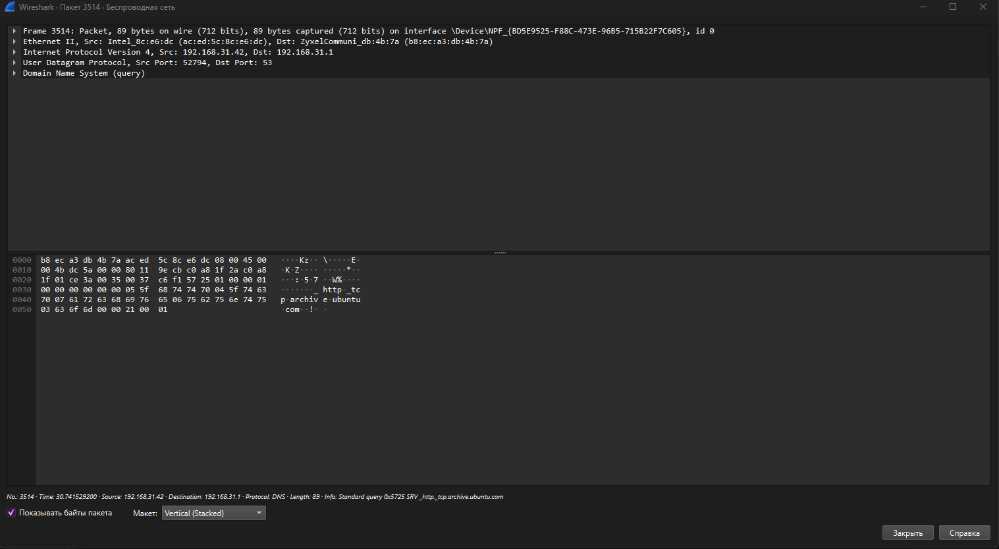
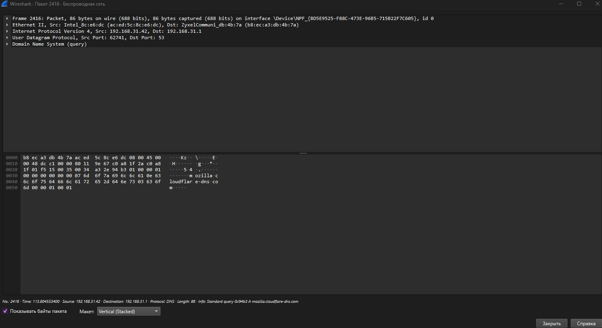
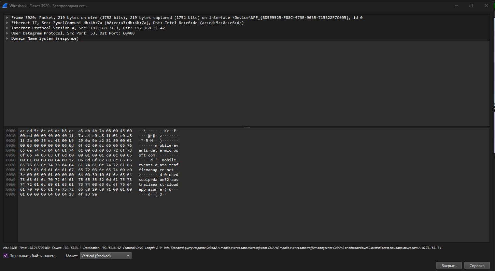

## Задание 2. Wireshark, UDP

Фильтр `udp` → уточнён до `udp && ip.addr == 192.168.31.42`, выбран пакет № 3514.

| Поле                 | Значение                                                |
| -------------------- | ------------------------------------------------------- |
| IPv4                 | 192.168.31.42 → 192.168.31.1                            |
| **Source Port**      | **52794**                                               |
| **Destination Port** | **53**                                                  |
| Прикладной уровень   | DNS: Standard query SRV \_http.\_tcp.archive.ubuntu.com |

Передача идёт между портами **52794 и 53**. Destination Port = 53 — стандартный
порт службы DNS; Source Port = 52794 — эфемерный порт, выданный ОС браузеру.
Направление «эфемерный → сервис» показывает, что инициатор — мой компьютер.
UDP выбран потому, что DNS не устанавливает соединение: запрос и ответ
укладываются в одну датаграмму, и принадлежность данных приложению
определяется только парой портов.

## Задание 3. Wireshark, DNS

Фильтр `dns`, раскрыт `Domain Name System → Flags`.

| Флаг                       | Бит   | Запрос № 2416 | Ответ № 3920 | Смысл                    |
| -------------------------- | ----- | ------------- | ------------ | ------------------------ |
| `Response` (QR)            | 15    | No            | Yes          | 0 — запрос, 1 — ответ    |
| `Opcode`                   | 11–14 | Query (0)     | Query (0)    | тип операции             |
| `Authoritative` (AA)       | 10    | No            | No           | ответ от владельца зоны  |
| `Truncated` (TC)           | 9     | No            | No           | ответ обрезан, нужен TCP |
| `Recursion desired` (RD)   | 8     | Yes           | Yes          | клиент просит рекурсию   |
| `Recursion available` (RA) | 7     | No            | Yes          | сервер умеет рекурсию    |
| `Authenticated data` (AD)  | 5     | No            | No           | проверено по DNSSEC      |
| `Checking disabled` (CD)   | 4     | No            | No           | запрет проверки DNSSEC   |
| `Reply code` (RCODE)       | 0–3   | No error      | No error     | результат                |

Значения поля целиком: запрос — 0x0100, ответ — 0x8180.

|                | Запрос № 2416                | Ответ № 3920                                                        |
| -------------- | ---------------------------- | ------------------------------------------------------------------- |
| IPv4           | 192.168.31.42 → 192.168.31.1 | 192.168.31.1 → 192.168.31.42                                        |
| Порты UDP      | 62741 → 53                   | 53 → 60488                                                          |
| Имя            | mozilla.cloudflare-dns.com   | mobile.events.data.microsoft.com (CNAME-цепочка, A = 40.79.163.154) |
| Transaction ID | 0x…                          | 0x9ba2                                                              |

В запросе установлен только Recursion desired; в ответе дополнительно Response
и Recursion available, Reply code = No error. Authoritative сброшен — отвечает
рекурсивный резолвер (роутер), а не сервер-владелец зоны. Truncated, AD и CD
сброшены: ответ уместился в UDP, DNSSEC не применялся.
